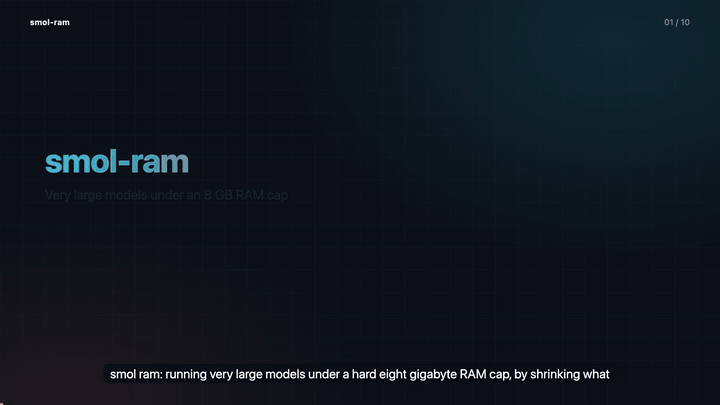
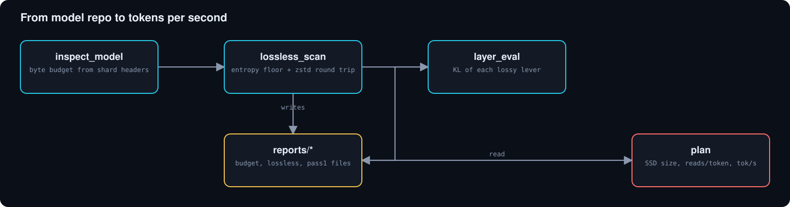
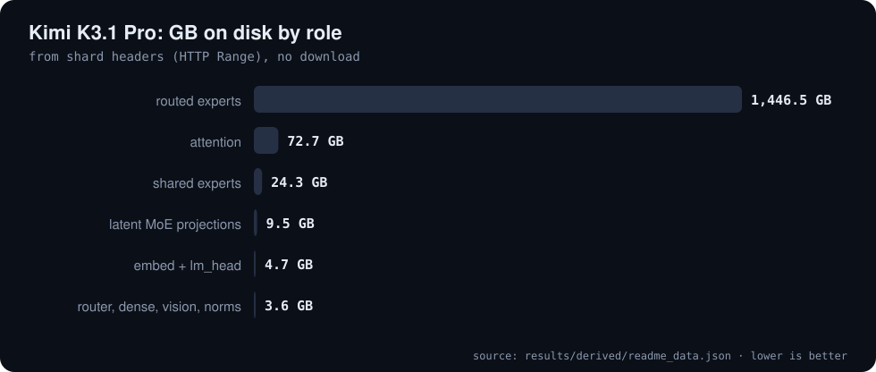
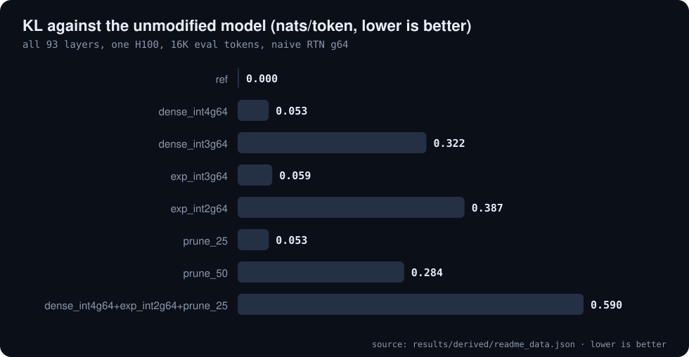
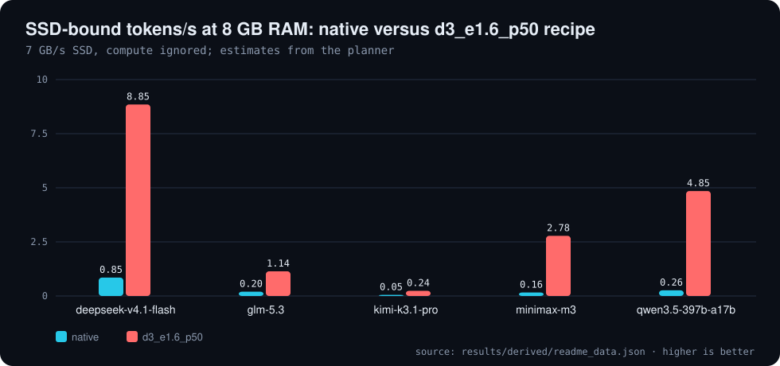

# 🪶 smol-ram

**Run very large models under a hard 8 GB RAM cap by shrinking what each token must read from SSD**

     

[🎬 Video](#video) · [🧰 Tools](#tools) · [📦 Where the bytes are](#bytes) · [🗜️ Lossless](#lossless) · [🔪 Lossy levers](#lossy) · [📈 Plan](#plan) · [⚠️ Caveats](#caveats) · [🗺️ Repo map](#repo-map)

---

**Explainer video (voice-over and captions): the 8 GB problem, where the bytes are, lossless limits, lossy levers, the plan**

With 8 GB of RAM almost nothing stays resident, so each token **streams its weights from SSD**. Bytes on disk are close to bytes read per token,
so a smaller artifact is also a faster one. smol-ram measures where the bytes are in any safetensors model, how far lossless coding gets,
what each lossy lever costs in quality, and what that means for SSD-bound tokens per second. Kimi K3.1 Pro (2.78T parameters, 1,561 GB) is the first target.

## 🧰 Tools

| tool | what it does |
|---|---|
| `python3 -m smol.inspect_model <hf-repo>` | byte budget by tensor role from shard headers only (HTTP Range, no download) |
| `python3 -m smol.entropy_probe <hf-repo>` | lossless floor of packed low-bit tensors from sampled experts |
| `modal run --detach modal_app/lossless_scan.py` | exact entropy + verified zstd round-trip of every tensor, one container per shard |
| `modal run --detach modal_app/fetch_weights.py` | copy a repo into a Modal Volume (one container per shard) |
| `modal run --detach modal_app/layer_eval.py --variants ...` | layer-streamed end-to-end quality of compression variants on one GPU |
| `python3 -m smol.plan reports/*_budget.json` | SSD size, per-token reads and SSD-bound tok/s under a RAM cap |

## 📦 Where the bytes are

Routed experts: 92 MoE layers x 896 experts, top-16, stored as MXFP4 (QAT) with an E8M0 scale per 32. Attention: 69 KDA + 24 MLA/DSA layers in bf16. Each token reads **111.5 GB of always-active bf16** plus 25.8 GB of routed experts.

**Kimi K3.1 Pro: where the bytes are (reports/kimi-k3.1-pro_budget.json)**

| Role | GB |
| :--- | ---: |
| routed experts | 1,446.5 |
| attention | 72.7 |
| shared experts | 24.3 |
| latent MoE projections | 9.5 |
| embed + lm_head | 4.7 |
| router, dense, vision, norms | 3.6 |

Source: `results/derived/readme_data.json`

Unlike DeepSeek V4.1, GLM-5.3, MiniMax M3 or Qwen3.5-397B (10 to 24 GB always-active), K3.1's dense part dominates at 8 GB RAM. See [reports/plan_8gb.md](reports/plan_8gb.md).

## 🗜️ Lossless (bit-exact)

Full scan of all 96 shards: 1,561 GB to an entropy floor of 1,363 GB (87.3%); zstd-3 reaches 88.4%. Order-1 context on FP4 codes gains less than 0.2%, so neighbouring codes are close to independent. Details: [reports/kimi-k3.1-pro_lossless.md](reports/kimi-k3.1-pro_lossless.md).

**Lossless scan of all 96 shards (reports/kimi-k3.1-pro_lossless.md)**

| Stream | Native GB | Entropy floor % |
| :--- | ---: | ---: |
| routed_expert.codes | 1,361.4 | 94.0% |
| routed_expert.scales | 85.1 | 8.7% |
| attention | 72.7 | 66.5% |
| shared_expert | 24.3 | 66.2% |

Source: `results/derived/readme_data.json`

## 🔪 Lossy levers, measured end to end

All 93 layers, one H100, 16,368 eval tokens; KL is against the unmodified model; quantizers are naive RTN (g64). Pruning is the cheapest lever per GB: -322 GB for the same KL that int4 dense costs for -43 GB. Naive RTN below 4 bits is too lossy on this QAT model.

**Lossy levers, all 93 layers, one H100, 16K eval tokens (reports/kimi-k3.1-pro_pass1.json)**

| Variant | SSD GB (est.) | KL vs ref (nats/tok) | PPL |
| :--- | ---: | ---: | ---: |
| ref | 1,366 | 0.000 | 1.415 |
| dense_int4g64 | 1,323 | 0.053 | 1.483 |
| dense_int3g64 | 1,316 | 0.322 | 1.935 |
| exp_int3g64 | 1,268 | 0.059 | 1.493 |
| exp_int2g64 | 928 | 0.387 | 2.073 |
| prune_25 | 1,044 | 0.053 | 1.475 |
| prune_50 | 721 | 0.284 | 1.856 |
| dense_int4g64+exp_int2g64+prune_25 | 673 | 0.590 | 2.527 |

Source: `results/derived/readme_data.json`

## 📈 Plan at 8 GB RAM

SSD 7.0 GB/s, reads are SSD-bound and compute is ignored. Kimi K3.1 Pro: 0.05 tok/s native, 0.24 tok/s with the d3_e1.6_p50 recipe (300 GB); that recipe's quality has not been measured end to end.

**SSD-bound tokens/s at 8 GB RAM, 7 GB/s SSD (reports/plan_8gb.md)**

| Model | Recipe | SSD GB | tok/s |
| :--- | :--- | ---: | ---: |
| deepseek-v4.1-flash | native | 510 | 0.85 |
| deepseek-v4.1-flash | lossless | 509 | 0.94 |
| deepseek-v4.1-flash | d4 | 505 | 1.52 |
| deepseek-v4.1-flash | d4_e2 | 296 | 5.23 |
| deepseek-v4.1-flash | d3_e2_p50 | 252 | 5.47 |
| deepseek-v4.1-flash | d3_e1.6_p50 | 236 | 8.85 |
| glm-5.3 | native | 756 | 0.20 |
| glm-5.3 | lossless | 755 | 0.20 |
| glm-5.3 | d4 | 747 | 0.26 |
| glm-5.3 | d4_e2 | 242 | 0.64 |
| glm-5.3 | d3_e2_p50 | 125 | 0.80 |
| glm-5.3 | d3_e1.6_p50 | 83 | 1.14 |
| kimi-k3.1-pro | native | 1,560 | 0.05 |
| kimi-k3.1-pro | lossless | 1,364 | 0.08 |
| kimi-k3.1-pro | d4 | 1,321 | 0.14 |
| kimi-k3.1-pro | d4_e2 | 885 | 0.17 |
| kimi-k3.1-pro | d3_e2_p50 | 453 | 0.21 |
| kimi-k3.1-pro | d3_e1.6_p50 | 300 | 0.24 |
| minimax-m3 | native | 853 | 0.16 |
| minimax-m3 | lossless | 568 | 0.26 |
| minimax-m3 | d4 | 559 | 0.40 |
| minimax-m3 | d4_e2 | 138 | 1.57 |
| minimax-m3 | d3_e2_p50 | 72 | 1.76 |
| minimax-m3 | d3_e1.6_p50 | 49 | 2.78 |
| qwen3.5-397b-a17b | native | 806 | 0.26 |
| qwen3.5-397b-a17b | lossless | 537 | 0.45 |
| qwen3.5-397b-a17b | d4 | 530 | 0.69 |
| qwen3.5-397b-a17b | d4_e2 | 130 | 2.95 |
| qwen3.5-397b-a17b | d3_e2_p50 | 68 | 3.04 |
| qwen3.5-397b-a17b | d3_e1.6_p50 | 45 | 4.85 |

Source: `results/derived/readme_data.json`

## 🔭 Next

1. Better quantizers: GPTQ/HQQ with per-expert calibration Hessians; codebook/trellis at 2 to 2.5 bpw.
2. Better pruning: REAP-style saliency (gate weight x output norm) and expert merging, with more calibration tokens.
3. Runtime: mmap/stream engine under `memory.max=8G` with an entropy decoder fast enough for 7 GB/s.

## ⚠️ Honest caveats

- Quality numbers come from one H100 run, 16K wikitext-2 tokens, naive RTN quantizers; reference perplexity is 1.41 (largely memorised), so KL against the unmodified model is the metric.
- Tokens per second are SSD-bound estimates from the planner (compute ignored); recipes other than the measured levers are projections.
- There is no streaming runtime yet; the repo contains the measurement and planning tools, not compressed model weights.

## 🗺️ Repo map

| Path | What it is |
|---|---|
| `smol/` | inspect_model, entropy_probe and plan tools |
| `modal_app/` | lossless_scan, fetch_weights and layer_eval for Modal |
| `reports/` | budget, lossless and pass-1 results for Kimi K3.1 Pro; budgets for four other models; plan_8gb.md |
| `tools/readme_data.py` | derives README and video numbers from reports/ |
| `docs/README_FULL.md` | the previous README, kept for reference |
| `README.spec.yml` | spec for video-readme-maker |
| `video/` | explainer mp4, srt, poster, preview.gif (generated) |

---

Generated with video-readme-maker from README.spec.yml and reports/.

